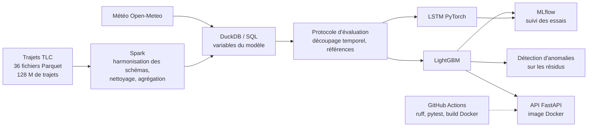
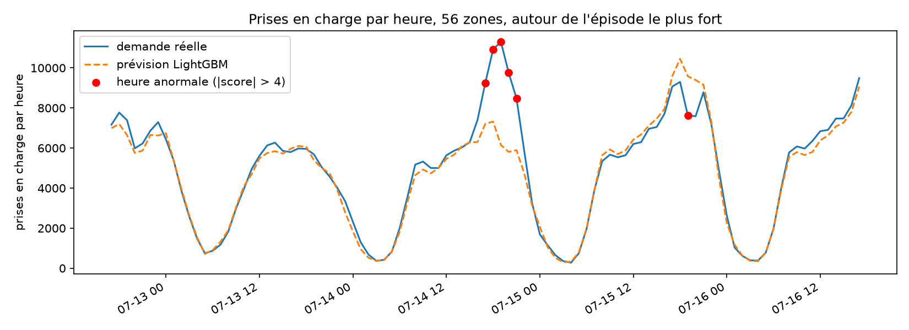

# Prévision de la demande de taxis à New York


Prévoir, chaque soir à minuit, le nombre de prises en charge de taxis jaunes **pour chaque zone de New York et chaque heure du lendemain**, puis **détecter les heures anormales** où la demande s'écarte nettement de la prévision.

Le projet couvre toute la chaîne : traitement de **128 millions de trajets avec Spark**, variables calculées **en SQL**, modèles **LightGBM** et **PyTorch** évalués avec un protocole strict, suivi des expériences avec **MLflow**, **API FastAPI**, **Docker** et **intégration continue**.

**Résultat principal** : sur la période de test (octobre à décembre 2025, jamais utilisée avant l'évaluation finale), le modèle LightGBM se trompe de **14,2 %** de la demande, contre **20,6 %** pour la meilleure méthode simple. Son avantage est le plus grand pendant les fêtes : **15,1 % contre 27,6 %** en décembre.

---

## Sommaire

1. [Architecture](#architecture)
2. [Résultats](#résultats)
3. [Démarche](#démarche)
4. [Protocole d'évaluation](#protocole-dévaluation)
5. [Détection d'anomalies](#détection-danomalies)
6. [Limites](#limites)
7. [Pistes d'amélioration](#pistes-damélioration)
8. [Installation et utilisation](#installation-et-utilisation)
9. [Structure du dépôt](#structure-du-dépôt)
10. [Ce que j'ai appris](#ce-que-jai-appris)

---

## Architecture



| Composant | Choix |
|---|---|
| Données | trajets des taxis jaunes (NYC TLC), 2023 à 2025 ; météo horaire à Central Park (Open-Meteo) |
| Traitement | PySpark en local (16 cœurs), sous Ubuntu (WSL 2) |
| Variables | DuckDB, SQL avec fonctions de fenêtrage |
| Modèles | LightGBM (gradient boosting) et LSTM (PyTorch) |
| Suivi des expériences | MLflow |
| Service | FastAPI, Uvicorn, Docker |
| Qualité | pytest (11 tests), ruff, GitHub Actions |

---

## Résultats

### Prévision sur le test (octobre à décembre 2025)

La WAPE est la somme des erreurs divisée par la demande totale (voir [Protocole](#protocole-dévaluation)). Les intervalles de confiance à 95 % sont obtenus par bootstrap sur les jours.

| Modèle | WAPE test | IC 95 % | WAPE validation |
|---|---|---|---|
| Référence : moyenne des 4 dernières semaines, même créneau | 20,6 % | [18,0 ; 23,4] | 20,1 % |
| LSTM (PyTorch) | 15,1 % | [14,2 ; 16,0] | 15,1 % |
| LightGBM (entraîné jusqu'au 30/06/2025) | 14,2 % | [13,4 ; 15,1] | 14,1 % |
| **LightGBM final (réentraîné jusqu'au 30/09/2025)** | **14,2 %** | **[13,4 ; 15,0]** | - |

- **Le modèle bat nettement la référence** : écart de WAPE compris entre -8,8 et -4,3 points.
- **LightGBM bat le LSTM**, sur la validation comme sur le test (écart entre -1,2 et -0,6 point).
- **Le test confirme la validation presque au dixième près** : la validation, qui a servi à choisir le modèle, n'était pas trop optimiste.
- Réentraîner avec trois mois de données en plus n'apporte presque rien (écart entre -0,1 et 0 point).

### L'erreur mois par mois

| Mois | Modèle final | Référence |
|---|---|---|
| Octobre | 13,0 % | 14,3 % |
| Novembre | 14,5 % | 20,0 % |
| Décembre | 15,1 % | **27,6 %** |

La référence suppose que la demande se répète d'une semaine à l'autre : pendant Thanksgiving et les fêtes de fin d'année, elle s'effondre. Le modèle, qui connaît les jours fériés et combine plusieurs historiques, tient. **Son avantage est le plus grand justement quand les habitudes changent.**

### Choix du modèle (sur la validation, juillet à septembre 2025)

| Essai | WAPE |
|---|---|
| Référence : la veille, même heure | 27,3 % |
| Référence : la semaine précédente, même heure | 21,8 % |
| Référence : moyenne des 4 dernières semaines, même créneau | 20,1 % |
| LightGBM, perte L2 | 14,6 % |
| LightGBM, perte L1 | 14,1 % |
| LightGBM, perte de Poisson | 14,1 % |
| **LightGBM, perte de Poisson, sans météo (retenu)** | **14,1 %** |
| LSTM | 15,1 % |

- **La fonction de perte change peu** (L1 et Poisson à égalité).
- **La météo n'apporte rien en moyenne** (écart entre -0,2 et +0,2 point), alors même que le modèle recevait la météo **réellement observée**, un avantage irréaliste. Le modèle retenu s'en passe : aussi bon, plus simple, et utilisable sans prévision météo.
- **Le modèle bat la référence dans les 56 zones.**

---

## Démarche

### 1. Ingestion

36 fichiers mensuels (2023 à 2025, 2,16 Go), la table des zones et la météo horaire. Le script est **idempotent** (relancé, il ne retélécharge que les fichiers manquants), écrit dans un fichier temporaire renommé à la fin (aucun fichier incomplet en cas d'interruption), et vérifie chaque fichier.

Il **contrôle aussi les schémas**, et en a trouvé **trois différents** dans les fichiers officiels : des types différents pour les mêmes colonnes (entiers 32 ou 64 bits, entiers ou décimaux), une colonne dont le nom change de casse (`airport_fee` et `Airport_fee`), et une nouvelle colonne en 2025 (`cbd_congestion_fee`, liée au péage urbain de Manhattan).

### 2. Nettoyage et agrégation avec Spark

Chaque mois est lu séparément, réduit aux colonnes utiles et converti dans un schéma commun, puis les 36 mois sont assemblés. Chaque règle de nettoyage **marque** les trajets avant de les retirer, ce qui permet de produire un rapport de qualité mois par mois.

| Règle | Trajets retirés |
|---|---|
| Durée nulle, négative ou de plus de 5 h | 646 466 |
| Zone de départ inconnue ou hors de New York | 636 461 |
| Distance négative ou de plus de 100 miles | 5 787 |
| Date hors du mois du fichier | 1 364 |
| **Total** | **1,00 %** (126 918 348 trajets gardés) |

Les trajets à **distance nulle** (2,2 %) sont gardés : on prévoit des prises en charge, et un client est bien monté même si le compteur de distance a mal fonctionné.

Les trajets sont ensuite comptés par zone et par heure, puis la table est **complétée avec les heures sans aucun trajet** (à 0) : 263 zones × 26 304 heures = 6 917 952 lignes, dont 52 % de zéros. Sans cette étape, les décalages dans le temps de l'étape suivante seraient faux sans aucune erreur visible. Quatre vérifications automatiques contrôlent le résultat (nombre de lignes, somme des prises en charge égale aux trajets gardés, aucun doublon, aucune valeur manquante).

### 3. Variables en SQL (DuckDB)

**Règle** : une variable n'est autorisée que si elle est **connue la veille à minuit**. Aucun décalage de moins de 24 heures n'est donc utilisé.

- **Calendrier** : heure, jour de la semaine, mois, week-end, jours fériés de l'État de New York.
- **Demande passée de la zone** : même heure la veille, deux jours avant et la semaine précédente ; moyennes de la même heure sur 7 et 28 jours ; total et moyenne journalière des jours précédents ; moyenne des 4 dernières semaines au même créneau.
- **Météo** : température, précipitations, neige, vent (testée, puis écartée du modèle retenu).

### 4. Modèles

**LightGBM** : quatre essais qui ne diffèrent que par un seul choix à la fois (trois fonctions de perte, avec et sans météo), avec arrêt anticipé sur la validation. Un premier lancement a révélé que l'arrêt anticipé ne se déclenchait jamais (limite d'arbres atteinte) : relancé avec une vitesse d'apprentissage plus forte, il s'arrête entre 1 400 et 4 600 arbres, avec des scores inchangés.

**LSTM (PyTorch)** : un exemple par zone et par jour. Le réseau lit les 168 dernières heures de la zone, le calendrier du jour et la référence, puis prévoit les 24 heures du lendemain d'un coup. Il prédit une **correction de la référence**, avec une normalisation par zone calculée sur l'entraînement seulement, et une perte alignée sur la WAPE. 68 184 paramètres, environ 42 secondes par époque sur CPU.

LightGBM a été retenu : plus précis, environ 2 minutes d'entraînement contre 28, et plus simple. Moyenner les deux modèles n'apporte rien.

### 5. Service et qualité

- **API FastAPI** : prévisions d'une zone pour une date, liste des zones, épisodes anormaux, avec une documentation interactive (`/docs`) et des erreurs explicites (zone inconnue, date hors période, date mal formée).
- **Tests** : 11 tests, dont un qui vérifie que l'API donne exactement les mêmes prévisions que le modèle lancé hors de l'API.
- **Docker** : une image légère limitée aux dépendances de l'API.
- **Intégration continue** : à chaque envoi, GitHub Actions vérifie le style (ruff), lance les tests sur des **données synthétiques** générées pour l'occasion (les vraies données ne sont pas versionnées), construit l'image Docker et interroge l'API qu'elle contient.

---

## Protocole d'évaluation

| Période | Dates | Rôle |
|---|---|---|
| Entraînement | 08/01/2023 au 30/06/2025 | apprentissage (la première semaine est exclue, faute de décalage de 168 h) |
| Validation | 01/07 au 30/09/2025 | choix et réglage des modèles |
| Test | 01/10 au 31/12/2025 | **verrouillé**, évalué une seule fois à la fin |

- **Découpage dans le temps**, jamais au hasard : on apprend sur le passé, on évalue sur le futur.
- **56 zones**, qui représentent 96 % des prises en charge, **classées sur l'entraînement seulement**, pour ne pas utiliser d'information du test.
- **Mesure principale : la WAPE**, et non la MAPE, impossible à calculer quand la demande vaut 0 (52 % des heures de la table complète).
- **Références simples** à battre : un modèle qui ne fait pas mieux qu'une moyenne des semaines passées ne sert à rien.
- **Intervalles de confiance par bootstrap sur les jours** (et non sur les heures, corrélées entre elles) ; un modèle n'est déclaré meilleur que si l'intervalle de l'écart exclut 0.
- **Évaluation finale fixée à l'avance** : modèles comparés, hypothèses et événements écrits avant de lancer le script une seule fois.

---

## Détection d'anomalies

L'écart entre la demande réelle et la prévision est rapporté à la taille de l'heure (racine de la prévision), puis exprimé en score robuste propre à chaque zone (médiane et MAD). Une heure est anormale si son score dépasse 4. Les heures anormales sont aussi cherchées à l'échelle de toute la ville, et regroupées en épisodes.



**Sur la validation** :
- **Les inondations éclair du 14 juillet 2025**, listées avant l'analyse, sont **l'épisode n° 1** de la période : de 17 h à 21 h, environ 17 300 prises en charge de plus que prévu, dans 42 zones sur 56. Avec le métro en partie inondé, les gens se sont reportés sur les taxis.
- Le 4 juillet est détecté (demande plus faible que prévu) ; Labor Day ne l'est pas, ce qui est souhaitable : le modèle le prévoit déjà grâce à sa variable « jour férié ».

**Sur le test** :
- **Le changement d'heure du 2 novembre est détecté** : l'heure de 1 h y compte les trajets de deux vraies heures. La méthode repère aussi les problèmes de données.
- Thanksgiving, Noël, le réveillon et le marathon ne sont pas détectés : soit le modèle les prévoit déjà, soit leur effet est trop local pour ressortir à l'échelle de la ville.

**Deux observations faites après coup**, à confirmer :
- **Les veilles de fêtes sont en creux** : les 2 et 3 juillet (avant le long week-end du 4 juillet), la veille de Thanksgiving, les 23 et 24 décembre. Le même phénomène, sur des dates différentes, suggère une variable « veille de jour férié ».
- **Le lien avec la pluie ne s'est pas confirmé.** Sur la validation, 6 des 8 pics de demande inattendus coïncidaient avec une forte pluie, contre 7 à 12 % pour une fenêtre prise au hasard. Cette hypothèse, écrite avant l'évaluation finale, ne s'est pas reproduite sur le test (aucun épisode pluvieux sur 5). Elle reste peut-être valable pour les orages d'été, mais ce n'est plus qu'une hypothèse.

---

## Limites

- **Taxis jaunes seulement** : les VTC (Uber, Lyft), bien plus nombreux, ne sont pas modélisés. La hausse des trajets de taxis jaunes en 2025 (de 3 à plus de 4 millions par mois) n'est pas expliquée.
- **56 zones sur 263** : les zones peu desservies, presque toujours à 0, demanderaient une approche spécifique (demande intermittente).
- **Aucun réglage automatique des hyperparamètres**, ni pour LightGBM ni pour le LSTM.
- **L'importance des variables** (par le gain) varie selon les réglages : la demande passée au même créneau domine toujours, mais sa part exacte n'est pas fiable.
- **Les changements d'heure** créent deux artefacts par an (une heure à 0 au printemps, une heure doublée en automne).
- **Détection d'anomalies** : les écarts ont des queues épaisses, donc le seuil sert à classer les écarts et non à estimer une probabilité ; l'échelle de la ville masque les événements locaux ; plusieurs explications sont faites après coup.
- **L'API sert des variables préparées à l'avance**, sans ingestion en temps réel des nouveaux trajets.

---

## Pistes d'amélioration

1. Une variable **« veille de jour férié »**, suggérée à la fois par la validation et par le test.
2. **Ajouter les VTC** : plus de volume, et une étape Spark encore plus justifiée.
3. **Régler les hyperparamètres** (par exemple avec Optuna), chaque essai étant suivi dans MLflow.
4. **Une évaluation sur plusieurs périodes successives** (backtesting glissant), plutôt qu'un seul découpage.
5. **Réentraîner automatiquement** chaque mois quand de nouvelles données sont publiées, avec un orchestrateur.
6. **Déployer l'API sur le cloud**.
7. **Détecter les anomalies par groupes de zones voisines**, pour repérer les événements locaux comme le marathon.

---

## Installation et utilisation

### Prérequis

- Linux ou WSL 2 (Spark fonctionne mal directement sous Windows)
- Python 3.12 et Java 17 ou 21
- Environ 5 Go d'espace disque, Docker pour l'image de l'API

### Installation

```bash
git clone git@github.com:MohamedN7/nyc-taxi-demand.git
cd nyc-taxi-demand
python3 -m venv .venv
source .venv/bin/activate
pip install -r requirements.txt
```

### Reproduire le pipeline

```bash
python src/ingest.py              # téléchargement et contrôle des schémas
python src/clean_aggregate.py     # Spark : nettoyage et table zone x heure
python src/features.py            # DuckDB : variables du modèle
python src/baselines.py           # zones, découpage, références
python src/train_lgbm.py          # LightGBM, suivi dans MLflow
python src/train_lstm.py          # LSTM PyTorch
python src/anomalies.py           # détection d'anomalies sur la validation
python src/final_eval.py          # évaluation finale sur le test (une seule fois)
python src/export_serving.py      # fichiers servis par l'API
```

Pour consulter les expériences :

```bash
mlflow ui --backend-store-uri sqlite:///mlflow.db --port 5000
```

### Lancer l'API

```bash
uvicorn app.main:app --reload
```

Puis ouvrir http://localhost:8000/docs. Exemple : `GET /forecast?zone_id=132&date=2025-11-15` (aéroport JFK).

### Avec Docker

Les fichiers servis doivent avoir été générés (`src/export_serving.py`).

```bash
docker build -t taxi-api .
docker run --rm -p 8000:8000 taxi-api
```

### Tests

```bash
pytest                                                # avec les vraies données
python tests/make_serving_fixture.py /tmp/serving_test
SERVING_DIR=/tmp/serving_test pytest                  # comme dans la CI
ruff check src app tests
```

---

## Structure du dépôt

```
nyc-taxi-demand/
├── src/
│   ├── explore_month.py          # premier contact avec Spark (un mois)
│   ├── ingest.py                 # téléchargement, vérification, contrôle des schémas
│   ├── clean_aggregate.py        # Spark : harmonisation, nettoyage, table zone x heure
│   ├── features.py               # DuckDB : variables en SQL
│   ├── eval_lib.py               # protocole commun : découpage, mesures, bootstrap
│   ├── baselines.py              # zones retenues et références
│   ├── train_lgbm.py             # LightGBM et MLflow
│   ├── train_lstm.py             # LSTM PyTorch
│   ├── anomalies.py              # détection d'anomalies
│   ├── check_weather_episodes.py # pluie pendant les épisodes
│   ├── check_rain_baseline.py    # taux de base des fenêtres pluvieuses
│   ├── final_eval.py             # évaluation finale sur le test
│   └── export_serving.py         # fichiers servis par l'API
├── app/
│   └── main.py                   # API FastAPI
├── tests/
│   ├── test_metrics.py           # mesures et découpage
│   ├── test_api.py               # API
│   └── make_serving_fixture.py   # données synthétiques pour la CI
├── config/
│   ├── zones.json                # les 56 zones retenues
│   ├── events.csv                # événements listés avant l'analyse (validation)
│   └── events_test.csv           # événements listés avant l'évaluation finale
├── reports/                      # résultats et figures
├── .github/workflows/ci.yml      # intégration continue
├── Dockerfile
├── requirements.txt              # environnement complet
├── requirements-api.txt          # dépendances de l'image Docker
├── requirements-ci.txt           # dépendances de la CI
└── notes.md                      # journal des expériences
```

Les données (`data/`), les modèles (`models/`) et l'historique MLflow ne sont pas versionnés : ils sont régénérés par le pipeline.

---

## Ce que j'ai appris

- **Vérifier les données avant de les traiter** : les fichiers officiels avaient trois schémas différents, qu'une lecture directe aurait fait échouer ou mal interpréter.
- **Une grille complète est indispensable aux séries temporelles** : sans les heures à 0, tous les décalages auraient été faux, sans aucune erreur visible.
- **Se demander, pour chaque variable, si elle serait connue au moment de la prévision**, et classer les zones sur l'entraînement seulement : une fuite de données rend des résultats trop beaux sans prévenir.
- **Toujours comparer à une méthode simple**, et ne déclarer un modèle meilleur qu'avec un intervalle de confiance.
- **Le deep learning n'est pas automatiquement meilleur** : sur des données tabulaires avec de bonnes variables, LightGBM a été plus précis, plus rapide et plus simple que le LSTM.
- **Une hypothèse exploratoire doit être confirmée sur d'autres données** : le lien avec la pluie, net en été, ne s'est pas reproduit sur le test.
- **Un modèle n'est utile que s'il est servi et testé** : API, tests de cohérence, image Docker et intégration continue.

---

**Auteur** : Mohamed Saadi, élève ingénieur à l'ENSEEIHT (Sciences du Numérique, HPC & Big Data).